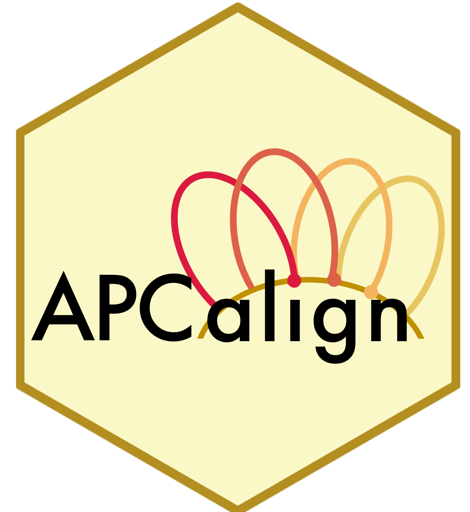

<!-- README.md is generated from README.Rmd. Please edit that file -->

```{r, include = FALSE}
knitr::opts_chunk$set(
  collapse = TRUE,
  comment = "#>",
  eval = FALSE
)
```

# APCalign-app 

'APCalign-app' is a Shiny interface to the ['APCalign' R package](https://traitecoevo.github.io/APCalign/).

The app enables users to align their Australian plant taxon name strings and update them to current, accepted standards set by the [Australian Plant Census (APC)](https://biodiversity.org.au/nsl/services/search/taxonomy).

The app can be accessed at: https://app.austraits.org/APCalign-app/

<!-- A screenshot of the app could be added here. -->

### To run the app locally:

#### Installation:

This app is currently not on CRAN, to install its current development version:

```{r, eval=FALSE}
remotes::install_github("traitecoevo/APCalign-app")
```

#### Load app:
```{r run}
library(APCalignApp)

align_app()
```

## How to cite

If you use APCalign-app, please cite the APCalign paper:

> Wenk EH, Cornwell WK, Fuchs A, Kar F, Monro AM, Sauquet H, Stephens RE, Falster DS (2024) **APCalign: An R package workflow and app for aligning and updating flora names to the Australian Plant Census.** *Australian Journal of Botany* 72(4):BT24014. <https://doi.org/10.1071/BT24014>

## License

APCalign-app is released under the MIT License (see `LICENSE.md`).

## AusTraits family

`APCalign-app` is part of the **AusTraits family** of packages maintained by the
[AusTraits](https://austraits.org) team. See **[austraits.org](https://austraits.org)** for the
project, the data, and the people behind it.

Contributing? Issues across the family are tracked on one board,
[AusTraits #9](https://github.com/orgs/traitecoevo/projects/9), and new issues are auto-added. Please
read the [issue & labelling guide](https://github.com/traitecoevo/austraits-meta/blob/main/governance/issue-guide.md)
in [`austraits-meta`](https://github.com/traitecoevo/austraits-meta) — the family's cross-package
knowledge and governance hub — before filing.

## Acknowledgements

AusTraits is made possible by contributions from our partner organisations — the
[University of New South Wales](https://www.unsw.edu.au/),
[Western Sydney University](https://www.westernsydney.edu.au/),
[Botanic Gardens of Sydney](https://www.botanicgardens.org.au/),
[the University of Melbourne](https://www.unimelb.edu.au/),
the [Atlas of Living Australia](https://www.ala.org.au/), and the Australian Government
[Department of Climate Change, Energy, the Environment and Water](https://www.dcceew.gov.au) — and
from our [advisory board, data contributors, and past partners](https://austraits.org/team/team-partners.html).

AusTraits is a co-investment partnership with the
[Australian Research Data Commons](https://ardc.edu.au/) (ARDC) through the Planet Research Data
Commons ([DOI: 10.3565/nyk4-4r91](https://doi.org/10.3565/nyk4-4r91)). The ARDC is enabled by the
Australian Government's [National Collaborative Research Infrastructure Strategy](https://www.education.gov.au/ncris)
(NCRIS).
